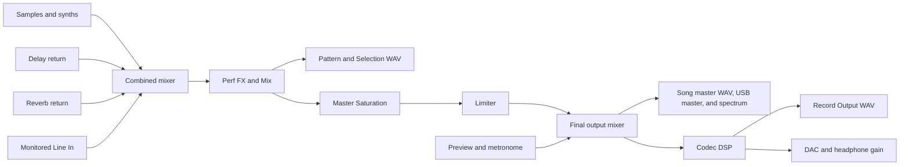

# Master audio and export routing

The return buses join the dry mix before Perf FX. The rack can process the track mix, Delay and Reverb returns, and monitored Line In together. Master Saturation runs once, between the rack and Limiter. The upstream mixers still clip to the PCM16 range.

## Export taps

| Export | Where it is captured |
| --- | --- |
| **Pattern** or **Selection** | After Perf FX, before Master Saturation and Limiter. Includes Delay, Reverb, and sequenced Perf FX. |
| **Song** | Final digital master, including Master Saturation and Limiter. |
| **Pattern Stems** or **Song Stems** | Sample and synth stems retain instrument processing, gain, and pan. The Delay and Reverb returns have their own WAVs. These stems are upstream of Perf FX. The included `master.wav` uses the Song master tap. |
| **USB audio** on Tracker+ and Mini | Channels 1–2 carry the final digital master. The individual track, synth, and return pairs use their own upstream taps. |
| **Record Output** on hardware | Stereo song recording after the codec’s Space, Bass Boost, and EQ, before the DAC and analog headphone gain. |

Offline export clears effect history and uses sequenced Perf FX, with monitored Line In muted. **Config → Project Settings → Render fader bypass** optionally sets sample-track fader gains to unity in Pattern and Selection renders, including their post-fader sends. Song and stems exports use the saved fader levels.

## Record Output

On Tracker, Tracker+, or Tracker Mini, choose **File → Export → Record Output**, then **Record**. The Tracker plays the song once from its first playlist entry using its internal clock and captures the effect tail. It saves `master.wav` in a numbered `Export/<project>/<project>_RecordOutput_NNNN/` folder.

The codec uses the hardware input path for its digital return. Line In and Mic are unavailable during the take. **Cancel** discards the take. The Tracker restores the input route and clock when the take ends. The codec applies Space, Bass Boost, and EQ in that order. [SGTL5000 signal flow, Figure 12](https://www.nxp.com/docs/en/data-sheet/SGTL5000.pdf#page=21)

## Differences from the original Tracker CE

This comparison uses Polyend Tracker CE at [`dbfa648`](https://github.com/polyend/tracker-ce/commit/dbfa648b92e4033a2d5308459bbe05bc92b78ec5).

| Signal or export | Original Tracker CE | SideTracker |
| --- | --- | --- |
| **Live master path** | Dry tracks and synths pass through the selected saturation curve in the dry mixer. The combined mix then applies the same curve before the Limiter. Delay, Reverb, and monitored Line In join at the combined mixer. | Dry mix, returns, and monitored Line In feed the master Perf FX rack. A single Master Saturation stage with adjustable Drive follows Perf FX, then the Limiter. |
| **Pattern and Selection** | Captured from the final digital master, with master saturation and limiting printed into the WAV. | Captured after Perf FX and before Master Saturation and Limiter. Delay, Reverb, and sequenced Perf FX are printed. Sample-track faders can optionally render at 0 dB. |
| **Song master and `master.wav` in stem exports** | Captured from the final digital master after the Limiter and before the codec. | Uses the same capture point. The WAV now reflects sequenced Perf FX and the single Master Saturation stage. |
| **Individual stems and USB audio** | Individual tracks and effect returns use upstream taps. On Plus and Mini, USB 1–2 carries the final digital master before the codec. | Keeps those capture points. USB 1–2 includes the new software master chain. |
| **Post-codec recording** | The offline exporter captures audio before the codec DSP. | **Record Output** captures the song in real time after the codec’s Space, Bass Boost, and EQ. The codec return replaces Line In and Mic for the take. |

[Original Tracker CE audio engine](https://github.com/polyend/tracker-ce/blob/dbfa648b92e4033a2d5308459bbe05bc92b78ec5/core/AudioEngine/mtAudioEngine.cpp) · [Original Tracker CE exporter](https://github.com/polyend/tracker-ce/blob/dbfa648b92e4033a2d5308459bbe05bc92b78ec5/core/Exporter/mtAudioExport.cpp)
